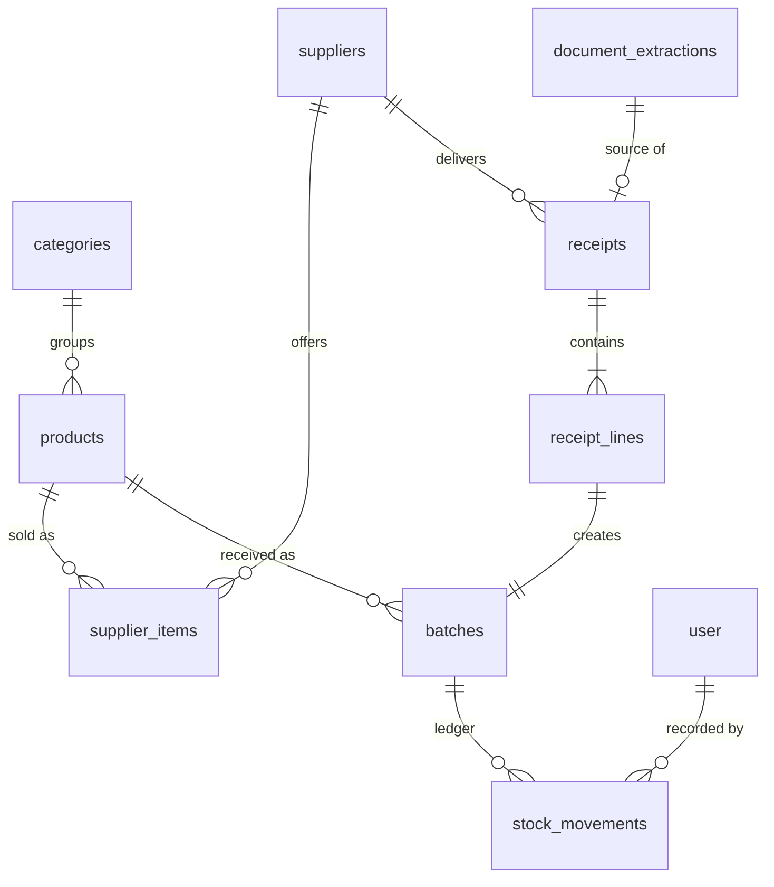

# Schema

PostgreSQL 17, Drizzle ORM 0.45.x. This document is the source of truth for the data model. If code and this file disagree, stop and resolve it here first.

## Conventions

- Primary keys are `uuid` (`gen_random_uuid()`), except `stock_movements` which uses a `bigint` identity so ordering is unambiguous. Better Auth tables use `text` ids; foreign keys to users are `text`.
- Names are `snake_case` in the database and `camelCase` in Drizzle.
- Timestamps are `timestamptz`, stored in UTC. `expiry_date` and `delivery_date` are `date`: a calendar day in the business timezone, with no time part.
- Quantities are `numeric(14,3)` in the product's **base unit** (`each`, `g`, `ml`). The UI shows kg and L when values are large. There is no cross-unit conversion beyond pack size.
- Money prices and totals are integer minor units (`*_cents`). Per-base-unit cost is `numeric(14,6)`.
- Nothing that can be derived from the ledger is stored. There is no `quantity` column on `products` or `batches`.
- Drizzle: use `numeric(..., { mode: 'string' })` and `date(..., { mode: 'string' })` so values arrive as strings. Do arithmetic with `decimal.js`.

## Enums

| Enum | Values |
|---|---|
| `unit` | `each`, `g`, `ml` |
| `movement_type` | `receipt`, `usage`, `waste`, `adjustment` |
| `waste_reason` | `expired`, `spoiled`, `damaged`, `other` |
| `expiry_source` | `printed`, `estimated`, `manual` |
| `receipt_source` | `manual`, `ai_extraction` |
| `match_method` | `exact`, `suggested`, `manual`, `new_item` |
| `extraction_status` | `succeeded`, `failed_model`, `failed_validation` |
| `user_role` | `admin`, `staff` |

## Entity relationships



## Tables

### Better Auth tables

`user`, `session`, `account`, `verification` are generated by the Better Auth CLI. The anonymous plugin adds `isAnonymous boolean` to `user`. Add one more field: `role user_role not null default 'staff'` (guests are assigned `admin` by a server hook, never from client input). Do not hand-edit the generated columns.

### settings (single row)

| Column | Type | Notes |
|---|---|---|
| id | smallint PK | `check (id = 1)` |
| business_name | text not null | |
| currency | char(3) not null | ISO 4217, `PHP` |
| timezone | text not null | IANA name, `Asia/Manila` |
| expiry_warning_days | int not null default 3 | check `>= 0` |
| extraction_cap_per_user_daily | int not null default 5 | |
| extraction_cap_per_ip_daily | int not null default 10 | |
| extraction_cap_global_daily | int not null default 50 | |
| updated_at | timestamptz not null | |

### categories

`id`, `name text unique not null`, `sort_order int not null default 0`.

### products

| Column | Type | Notes |
|---|---|---|
| id | uuid PK | |
| sku | text unique not null | |
| name | text not null | |
| name_normalized | text not null | lowercase, punctuation stripped, set by app |
| category_id | uuid null FK categories | |
| base_unit | unit not null | |
| tracks_expiry | boolean not null default false | |
| shelf_life_days | int null | check `shelf_life_days > 0`; check `shelf_life_days is null or tracks_expiry` |
| reorder_point | numeric(14,3) not null default 0 | check `>= 0` |
| is_active | boolean not null default true | archive, never delete |
| created_at, updated_at | timestamptz | |

Indexes: `gin (name_normalized gin_trgm_ops)`; `(is_active)`.

### suppliers

`id`, `name text unique not null`, `contact_name`, `email`, `phone`, `lead_time_days int not null default 2 check (>= 0)`, `notes`, `is_active boolean default true`, `created_at`, `updated_at`.

### supplier_items

How a supplier sells a product. Also the alias table for matching delivery note text.

| Column | Type | Notes |
|---|---|---|
| id | uuid PK | |
| supplier_id | uuid FK suppliers not null | |
| product_id | uuid FK products not null | |
| supplier_sku | text null | |
| description | text not null | as printed on documents |
| description_normalized | text not null | set by app |
| pack_label | text not null | for example `case of 12 x 1 L` |
| pack_quantity | numeric(14,3) not null | check `> 0`; base units per pack |
| last_pack_cost_cents | int null | |
| created_at, updated_at | timestamptz | |

Constraints and indexes: `unique (supplier_id, description_normalized)`; `unique (supplier_id, supplier_sku) where supplier_sku is not null`; `gin (description_normalized gin_trgm_ops)`; `(product_id)`.

### document_extractions

One row per extraction attempt. Used for rate limiting, cost tracking and debugging.

| Column | Type | Notes |
|---|---|---|
| id | uuid PK | |
| created_by | text FK user not null | |
| model_id | text not null | e.g. `alibaba/qwen3.8-omni-flash` |
| reasoning | text null | |
| status | extraction_status not null | |
| raw_output | jsonb null | what the model returned |
| parsed_output | jsonb null | after Zod validation |
| error_message | text null | |
| client_ip_hash | text null | salted hash of the client IP, never the raw IP; used for per-IP caps |
| input_tokens, output_tokens, latency_ms | int null | |
| created_at | timestamptz not null default now() | |

Index: `(created_by, created_at)`; `(client_ip_hash, created_at)`; `(created_at)`.

### receipts

| Column | Type | Notes |
|---|---|---|
| id | uuid PK | |
| supplier_id | uuid FK not null | |
| delivery_date | date not null | |
| reference | text null | delivery note or invoice number |
| source | receipt_source not null | |
| extraction_id | uuid null FK document_extractions | |
| idempotency_key | uuid not null unique | generated client-side when the form opens; makes confirm safe to repeat |
| created_by | text FK user not null | |
| created_at | timestamptz not null default now() | |

### batches

One delivered lot of one product. Created for every received line, perishable or not.

| Column | Type | Notes |
|---|---|---|
| id | uuid PK | |
| product_id | uuid FK not null | |
| supplier_id | uuid null FK | |
| lot_code | text null | |
| received_at | timestamptz not null default now() | |
| expiry_date | date null | |
| expiry_source | expiry_source null | |
| unit_cost | numeric(14,6) null | cost per base unit, check `>= 0` |
| initial_quantity | numeric(14,3) not null | check `> 0`; record of what arrived |
| created_at | timestamptz not null default now() | |

Constraints: `unique (id, product_id)` (target of the composite FK from movements); `check ((expiry_date is null) = (expiry_source is null))`. The app guarantees an expiry date for products with `tracks_expiry`.

Index for FEFO: `(product_id, expiry_date nulls last, received_at, id)`.

### receipt_lines

| Column | Type | Notes |
|---|---|---|
| id | uuid PK | |
| receipt_id | uuid FK not null | on delete restrict |
| batch_id | uuid not null unique FK batches | |
| supplier_item_id | uuid null FK | |
| description_printed | text null | |
| pack_count | numeric(14,3) not null | check `> 0` |
| pack_quantity | numeric(14,3) not null | snapshot of base units per pack, check `> 0` |
| line_cost_cents | int null | |
| match_method | match_method not null | how the line was linked to a product |

### stock_movements (the ledger)

| Column | Type | Notes |
|---|---|---|
| id | bigint identity PK | |
| movement_group_id | uuid not null default gen_random_uuid() | groups the rows of one user action (a FEFO allocation spans batches) |
| batch_id | uuid not null | |
| product_id | uuid not null | denormalised for fast per-product queries |
| type | movement_type not null | |
| quantity | numeric(14,3) not null | signed, base units |
| waste_reason | waste_reason null | |
| note | text null | |
| occurred_at | timestamptz not null default now() | business time |
| created_by | text FK user not null | |
| created_at | timestamptz not null default now() | |

Constraints:

- `foreign key (batch_id, product_id) references batches (id, product_id)` so the denormalised product id can never disagree.
- `check (quantity <> 0)`
- `check (type <> 'receipt' or quantity > 0)`
- `check (type not in ('usage','waste') or quantity < 0)`
- `check ((type = 'waste') = (waste_reason is not null))`

Indexes: `(batch_id)`, `(product_id, occurred_at desc)`, `(movement_group_id)`.

## SQL that Drizzle cannot generate

Add these as custom migrations (`drizzle-kit generate --custom`) after the tables exist.

```sql
create extension if not exists pg_trgm;

-- "today" in the business timezone
create function business_today() returns date
language sql stable as $$
  select (now() at time zone (select timezone from settings where id = 1))::date
$$;

-- the ledger is append-only
create function forbid_ledger_mutation() returns trigger
language plpgsql as $$
begin
  raise exception 'stock_movements is append-only';
end $$;

create trigger stock_movements_no_update_delete
before update or delete on stock_movements
for each row execute function forbid_ledger_mutation();

-- safety net: a batch can never end a transaction below zero
create function assert_batch_non_negative() returns trigger
language plpgsql as $$
declare total numeric(14,3);
begin
  select coalesce(sum(quantity), 0) into total
  from stock_movements where batch_id = new.batch_id;
  if total < 0 then
    raise exception 'batch % would go negative (%)', new.batch_id, total;
  end if;
  return null;
end $$;

create constraint trigger stock_movements_non_negative
after insert on stock_movements
deferrable initially deferred
for each row execute function assert_batch_non_negative();

-- derived stock
create view batch_stock as
select b.id as batch_id, b.product_id, b.expiry_date, b.received_at, b.unit_cost,
       coalesce(sum(m.quantity), 0)::numeric(14,3) as quantity_on_hand
from batches b
left join stock_movements m on m.batch_id = b.id
group by b.id;

create view product_stock as
select p.id as product_id,
       coalesce(sum(bs.quantity_on_hand)
         filter (where bs.expiry_date is null or bs.expiry_date >= business_today()), 0) as usable_quantity,
       coalesce(sum(bs.quantity_on_hand)
         filter (where bs.expiry_date < business_today()), 0) as expired_quantity
from products p
left join batch_stock bs on bs.product_id = p.id and bs.quantity_on_hand > 0
group by p.id;
```

`TRUNCATE` does not fire the row-level append-only trigger. Only the demo reset script may truncate, and only when `DEMO_MODE=true`.

## Locking rule

`SELECT ... FOR UPDATE` cannot be used on the aggregate views. Any code that inserts movements for a batch must first lock that batch row, then read quantities, then insert.

For product-level FEFO usage (`record-usage.ts`), lock all usable batches for the product:

```sql
select id from batches
where product_id = $1
  and (expiry_date is null or expiry_date >= business_today())
order by expiry_date nulls last, received_at, id
for update;
```

For batch-specific mutations (`record-waste.ts`, `record-adjustment.ts`), lock the target batch directly regardless of expiry date:

```sql
select id from batches
where id = $1
for update;
```

Then read `batch_stock` for those ids in the same transaction. Receiving only creates new batches, so it needs no lock.

## Key queries

| Need | Query shape |
|---|---|
| Low stock | `product_stock.usable_quantity <= products.reorder_point and products.is_active` |
| Use soon | `batch_stock where quantity_on_hand > 0 and expiry_date between business_today() and business_today() + warning_days` |
| Write off | `batch_stock where quantity_on_hand > 0 and expiry_date < business_today()` |
| Waste value | `sum(abs(quantity) * unit_cost) from stock_movements join batches where type = 'waste'` grouped by reason, product, month |
| Rate limit | `count(*) from document_extractions` filtered by `created_by`, by `client_ip_hash`, or globally, with `created_at >= start of business day (Asia/Manila)` |
| Match (alias) | `supplier_items where supplier_id = $1 order by similarity(description_normalized, $2) desc limit 3` |

## Planned later migration (phase 5): recipes and sales import

Not built yet. Do not add these now; they are recorded so the current schema does not block them.

- `stock_movements.external_ref text null`, with a partial unique index `(external_ref) where external_ref is not null`. Each imported sales line carries a stable reference (for example `salesfile-2026-11-05:line-17`), so importing the same file twice cannot deduct stock twice. Usage from imports uses the existing `usage` movement type and the same FEFO allocation.
- `menu_items` (id, name, price_cents, is_active) and `menu_item_ingredients` (menu_item_id, product_id, quantity in base unit). A sale of 2 lattes becomes usage of 2 x each ingredient.
- `sales_imports` (id, source, file_name, row_count, status, created_by, created_at) to record each import and make it reviewable.
- Unmapped sale items are listed for the user to map, never silently ignored.

## Seed data

Deterministic (seeded PRNG), so the demo looks the same every reset:

- 1 fictional business in the Philippines, 5 categories, about 45 products with local flavour (fresh milk, evaporated and condensed milk, oat milk, coffee beans, ube and calamansi syrups, pandesal, ensaymada, eggs, mangoes, cups and lids), a mix of tracked and untracked. Use fictional supplier names, never real brands.
- 6 suppliers with 2 to 8 supplier items each, with realistic pack labels.
- 8 weeks of receipts and usage so batches have history, a few batches expiring within 3 days, 2 or 3 already expired, and several products below reorder point.
- Owner account (admin) from `ADMIN_EMAIL` and `ADMIN_PASSWORD`. No shared demo logins: guests are created on demand and removed by the nightly reset.
- Sample delivery notes for the AI flow live in `evals/fixtures/` and are linked from the demo.
